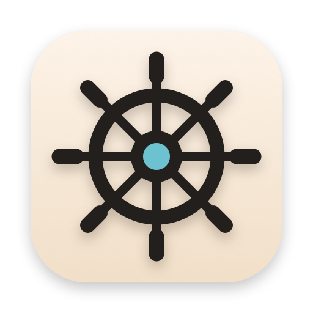

<p align="center">
  
</p>

<h1 align="center">Helm</h1>

<p align="center">
  <b>Drag, hold a key, drop.</b><br>
  A free, open-source file toolkit for macOS: convert, shrink and send files<br>
  from a wheel that opens right where you drag them.
</p>

<p align="center">
  <a href="https://github.com/Kaandis/helm/releases/latest"></a>
  
  
  <a href="LICENSE"></a>
</p>

<p align="center">
  <a href="https://kaandis.github.io/helm/">Website</a> ·
  <a href="https://github.com/Kaandis/helm/releases/latest/download/Helm.zip">Download</a> ·
  <a href="README.tr.md">Türkçe</a>
</p>

## What it does

Start dragging files in Finder or on the desktop and hold a key. A wheel opens under the pointer; drop the files on a slice and the result lands next to the original. Drop on the middle to cancel.

- **⇧ Convert.** Photos to JPG, PNG, HEIC, PDF or TIFF. PDF pages to PNG or JPG. Videos to MP4, MOV, a GIF or just their sound. Audio to M4A, WAV or AIFF.
- **⌘ Tools.** Compress or halve photos, strip their location and camera data, put them in one PDF, or read a QR code. Merge, split or compress PDFs. Compress or mute videos. Extract archives.
- **⌃ Actions.** AirDrop, copy the path, open Terminal there, or zip.
- **Only what fits.** Each wheel shows just the tools for the files you’re holding, and never offers a format they’re already in.
- **Your keys.** Give each wheel the key you like (⇧, ⌘, ⌃ or ⌥), turn Helm off for apps whose own drag shortcuts clash, or pause it from the menu bar.
- **Works with Harbor.** With [Harbor](https://kaandis.github.io/harbor/) installed, Helm’s settings appear there and apply at once.

## Why it works this way

- **No permissions.** Helm notices a drag by reading the system’s drag pasteboard and which modifier keys are down, both of which any app may read. No Accessibility, no Screen Recording, no Full Disk Access.
- **Nothing runs between drags.** A mouse press starts a short check that ends when the button comes up. The rest of the time Helm sits idle.
- **Built on what macOS already has.** ImageIO, PDFKit and AVFoundation do the work, so there’s nothing extra to download and no command-line tools bundled inside.
- **Never overwrites.** Results get a new name next to the original (or in Downloads, if you prefer), and the original stays as it was.
- **A short list on purpose.** Helm leaves out what needs a server, an account or a big download (cloud uploads, AI background removal, OCR models). Everything it offers works offline, in seconds.
- **Stays out of the way.** No wheel while an app is full screen, in apps you exclude, or when no wheel key is held, so ordinary drags behave exactly as before.

Helm takes real files. Apps that drag *promised* files instead (Photos, Mail attachments) don’t open a wheel yet; drag those to the desktop first.

## Install

1. Download **[Helm.zip](https://github.com/Kaandis/helm/releases/latest/download/Helm.zip)** and unzip it.
2. Move **Helm.app** to Applications and open it.
3. The first time, right-click Helm and choose **Open** (builds aren’t notarized yet), or run:

```bash
xattr -dr com.apple.quarantine /Applications/Helm.app
```

A short guide shows the three wheels. Helm lives in the menu bar, where you can pause it or open its settings.

## Building

Requires Xcode 26 and [XcodeGen](https://github.com/yonaskolb/XcodeGen).

```bash
xcodegen generate
xcodebuild -project Helm.xcodeproj -scheme Helm -configuration Release build
```

Releases are built with `scripts/release.sh`, which signs them with the “Harbor Apps Code Signing” certificate. `scripts/make-icon.swift` draws the icon and `scripts/sync-strings.py` rebuilds the English and Turkish strings. Debug builds can run one tool without the wheel: `Helm --run toJPG photo.heic`.

## Project layout

```
Helm/
  App/          app entry, menu bar and launch
  Core/         drag watching and preferences
  Wheel/        the wheel, its drop target and the progress toast
  Tools/        conversions and tools (ImageIO, PDFKit, AVFoundation)
  Settings/     the settings window
  Onboarding/   the guide
  Resources/    Info.plist, icon, strings, settings-schema.json
docs/           the website (GitHub Pages)
scripts/        release, icon and strings tools
```

## Disclaimer

Helm is an independent project and is not affiliated with, endorsed by or sponsored by Apple Inc. Mac and macOS are trademarks of Apple Inc., registered in the U.S. and other countries. Helm was written from scratch and shares no code with other file tools.

## License

[MIT](LICENSE)
