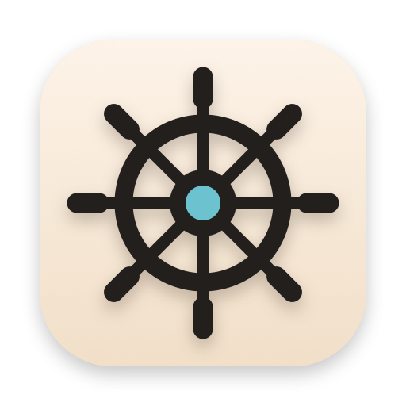

<p align="center">
  
</p>

<h1 align="center">Helm</h1>

<p align="center">
  <b>Sürükle, tuşa bas, bırak.</b><br>
  macOS için ücretsiz, açık kaynak bir dosya araç seti: dosyaları sürüklediğin yerde açılan<br>
  bir çarktan dönüştür, küçült ve gönder.
</p>

<p align="center">
  <a href="https://github.com/Kaandis/helm/releases/latest"></a>
  
  
  <a href="LICENSE"></a>
</p>

<p align="center">
  <a href="https://kaandis.github.io/helm/">Web sitesi</a> ·
  <a href="https://github.com/Kaandis/helm/releases/latest/download/Helm.zip">İndir</a> ·
  <a href="README.md">English</a>
</p>

## Ne yapar

Finder'da ya da masaüstünde dosyaları sürüklemeye başla ve bir tuşa bas. İşaretçinin altında bir çark açılır; dosyaları bir dilimin üstüne bırak, sonuç orijinalin yanına gelir. Vazgeçmek için ortaya bırak.

Ya da sürüklerken dosyaları git-gel-git şeklinde, sağa sola ya da yukarı aşağı salla: uyan tüm araçların çarklara göre gruplandığı büyük bir dümen açılır; bir tuşa basınca o çarka daralır.

- **⇧ Dönüştür.** Fotoğrafları JPG, PNG, HEIC, PDF ya da TIFF'e. PDF sayfalarını PNG ya da JPG'ye. Videoları MP4, MOV, GIF'e ya da yalnızca seslerine. Sesleri M4A, WAV ya da AIFF'e.
- **⌘ Araçlar.** Fotoğrafları sıkıştır ya da yarıya indir, konum ve kamera bilgilerini sil, arka planı sil, içindeki metni kopyala, hepsini tek PDF yap ya da QR kodu oku. PDF'leri birleştir, sayfalara böl, sıkıştır ya da metnini kopyala. Videoları sıkıştır ya da sesini kaldır. Arşivleri aç.
- **⌃ Eylemler.** Kes, AirDrop, yolu kopyala, Mail, zip'le, orada Terminal aç ya da bir görseli her yere yapıştırmak için kopyala.
- **Sonunda Kes.** Finder'da Kes yok. Dosyaları Kes'e bırak, köşedeki küçük bir rafta dokunulmadan beklesinler; rafı herhangi bir klasöre sürükleyince oraya taşınırlar, ya da o klasörde ⌥⌘V'ye bas. Rafı kapatırsan unutulurlar.
- **Yalnızca uyanlar.** Her çark yalnızca tuttuğun dosyalara uyan araçları gösterir; dosyaların zaten olduğu biçimi hiç önermez.
- **Senin tuşların.** Her çarka istediğin tuşu ver (⇧, ⌘, ⌃ ya da ⌥), kendi sürükleme kısayolları çakışan uygulamalarda Helm'i kapat ya da menü çubuğundan duraklat.
- **Senin tarzın.** Liquid Glass ya da Harbor'ın kremi, çember sekiz renkten biri, istediğin kadar şeffaf, küçükten büyüğe, yuvarlak ya da kare, tutamaklı ya da tutamaksız. Süzmek için tuşu basılı tut ya da bir kez bas; büyük dümende hangi araçların görüneceğini seç; sallamanın ne kadar hafif ya da sert olacağını ayarla.
- **Harbor ile çalışır.** [Harbor](https://kaandis.github.io/harbor/) kuruluysa Helm'in ayarları orada da görünür ve hemen uygulanır.

## Neden böyle çalışır

- **İzin istemez.** Helm bir sürüklemeyi, sistemin sürükleme panosunu ve basılı değiştirici tuşları okuyarak fark eder; ikisini de her uygulama okuyabilir. Erişilebilirlik, Ekran Kaydı ya da Tam Disk Erişimi yok.
- **Sürüklemeler arasında hiçbir şey çalışmaz.** Fareye basınca kısa bir kontrol başlar, düğme bırakılınca biter. Geri kalan zamanda Helm boşta bekler.
- **macOS'te zaten olanla yapılmış.** İşi ImageIO, PDFKit ve AVFoundation yapar; ayrıca indirilecek bir şey ya da içine gömülü komut satırı aracı yoktur.
- **Asla üzerine yazmaz.** Sonuçlar orijinalin yanına (ya da istersen İndirilenler'e) yeni bir adla kaydedilir, orijinal olduğu gibi kalır.
- **Bilerek kısa bir liste.** Bulut yüklemeleri gibi sunucu, hesap ya da büyük bir indirme gerektirenler yok. Arka plan silme ve metin okuma, Mac'inde zaten olan modelleri (Önizleme ve Fotoğraflar'ın kullandıklarını) kullanır; her şey çevrimdışı, saniyeler içinde çalışır.
- **Yoluna çıkmaz.** Bir uygulama tam ekranken, hariç tuttuğun uygulamalarda ya da çark tuşuna basmadıkça veya sallamadıkça çark açılmaz; sıradan sürüklemeler eskisi gibi davranır. Sallama iki hızlı geri dönüş demek; gezinen bir sürükleme sayılmaz.

Helm gerçek dosyaları alır. Bunun yerine *söz verilmiş* dosya sürükleyen uygulamalar (Fotoğraflar, Mail ekleri) henüz çark açmaz; önce onları masaüstüne sürükle.

## Kurulum

1. **[Helm.zip](https://github.com/Kaandis/helm/releases/latest/download/Helm.zip)** dosyasını indirip aç.
2. **Helm.app**'i Uygulamalar klasörüne taşı ve aç.
3. İlk seferde Helm'e sağ tıklayıp **Aç**'ı seç (sürümler henüz notarize edilmedi) ya da şunu çalıştır:

```bash
xattr -dr com.apple.quarantine /Applications/Helm.app
```

Kısa bir rehber üç çarkı gösterir. Helm menü çubuğunda yaşar; oradan duraklatabilir ya da ayarlarını açabilirsin.

## Derleme

Xcode 26 ve [XcodeGen](https://github.com/yonaskolb/XcodeGen) gerekir.

```bash
xcodegen generate
xcodebuild -project Helm.xcodeproj -scheme Helm -configuration Release build
```

Sürümler `scripts/release.sh` ile derlenir ve “Harbor Apps Code Signing” sertifikasıyla imzalanır. `scripts/make-icon.swift` simgeyi çizer, `scripts/sync-strings.py` İngilizce ve Türkçe metinleri yeniden oluşturur. Debug derlemeler çark olmadan tek bir araç çalıştırabilir: `Helm --run toJPG photo.heic`.

## Sorumluluk reddi

Helm bağımsız bir projedir; Apple Inc. ile bağlantılı değildir, Apple tarafından onaylanmamış veya desteklenmemiştir. Mac ve macOS, Apple Inc.'in ABD'de ve diğer ülkelerde tescilli ticari markalarıdır. Helm sıfırdan yazıldı ve başka dosya araçlarıyla kod paylaşmaz.

## Lisans

[MIT](LICENSE)
